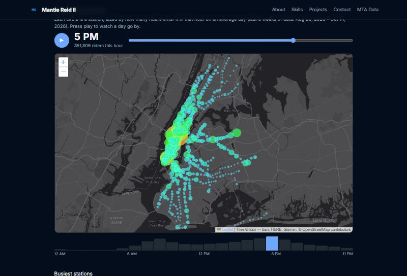
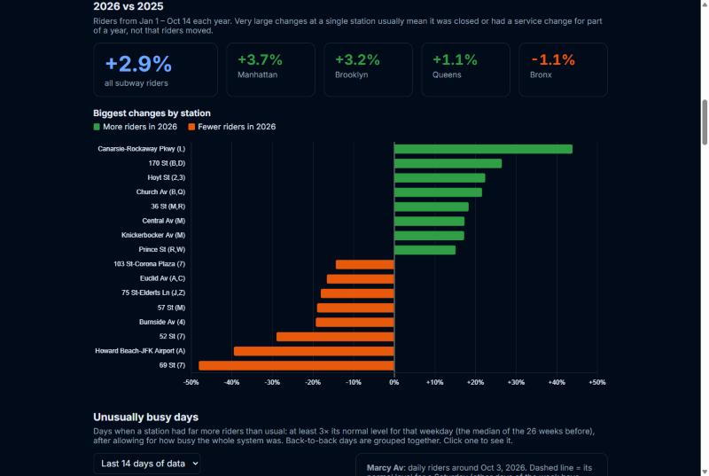
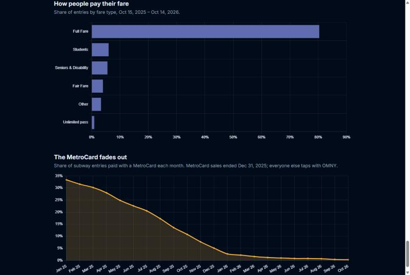
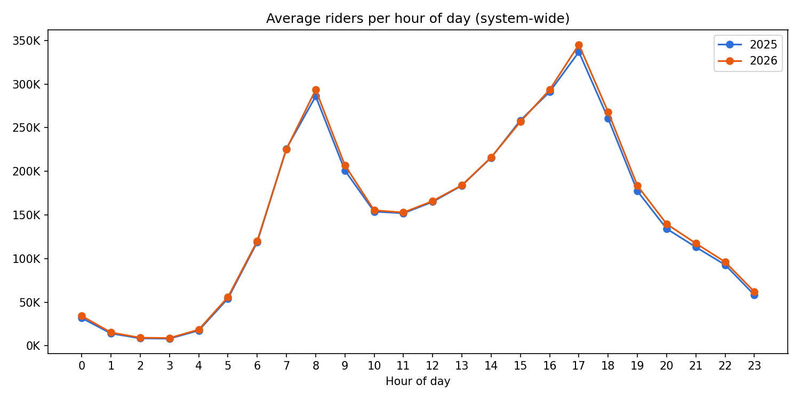
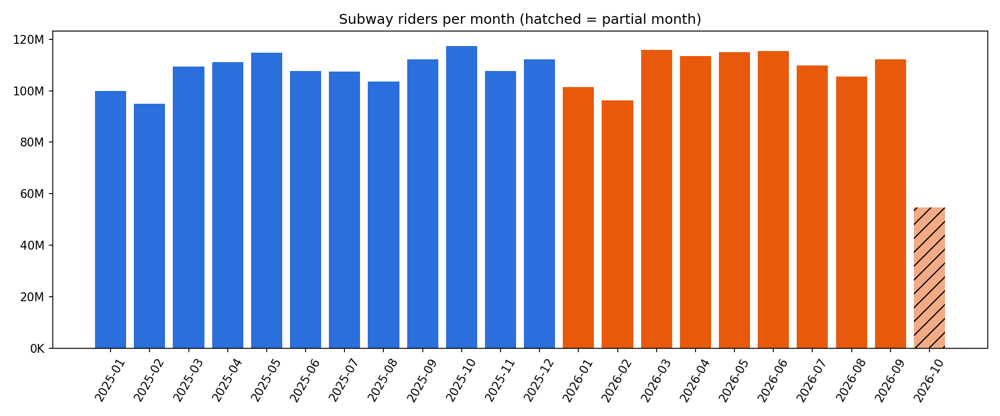
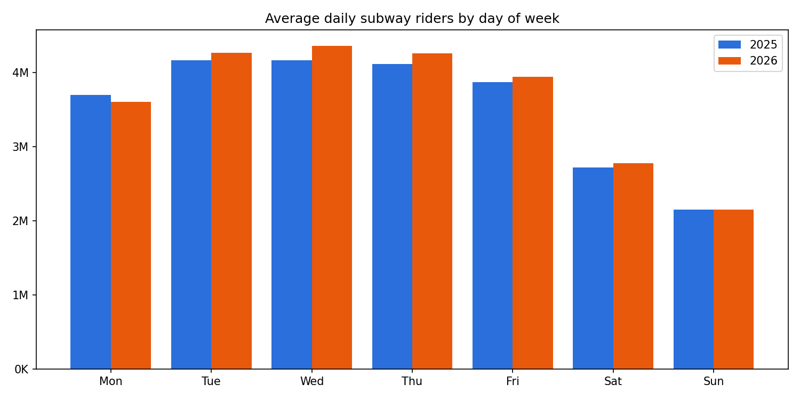
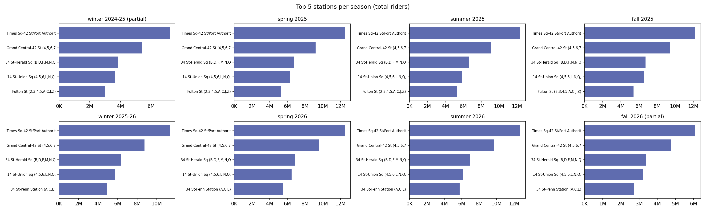

# NYC Subway Ridership Analysis (MTA Open Data, 2025–2026)

How New York rides the subway: the busiest stations, rush hours, seasons, unusual days, and
an animated map of a day on the subway, built from the MTA's hourly ridership data.

**Live demo:** [mantiereidii.com/mta-ridership](https://mantiereidii.com/mta-ridership/), updated daily.

By [Mantie Reid II](https://mantiereidii.com). Free to reuse with credit ([CC BY 4.0](#license)).

[](https://mantiereidii.com/mta-ridership/)

## What the data shows

- **About 3.6 million subway rides a day.** Times Sq-42 St is the busiest station, and 5 PM the busiest hour.
- **Ridership in 2026 is up 2.9%** on the same days of 2025: Manhattan +3.7%, Brooklyn +3.2%,
  Queens +1.1%, Bronx −1.1%.
- **Storms and holidays empty the subway:** a winter storm on Feb 23, 2026 cut ridership to 22% of a normal
  Monday, and Christmas to 35%.
- **Big events show up clearly.** Mets-Willets Point jumps to about 14× its normal riders during
  the US Open. The NYC Marathon, July 4th and Yankees games also stand out.
- **The MetroCard faded out:** from 33% of entries in January 2025 to under 1% by late 2026.

| 2026 vs 2025 | Fares and the MetroCard |
|---|---|
|  |  |

| Riders by hour of day | Riders per month |
|---|---|
|  |  |

| Riders by day of week | Top stations by season |
|---|---|
|  |  |

## What's in this repo

NYC subway ridership for 2025 and 2026 to date, from MTA's open data. It includes:

- `mta_ridership.py`: a Python script that writes small JSON/CSV summaries and PNG charts.
- `wordpress-plugin/`: a WordPress plugin that shows the same trends on a web page and refreshes them daily.

Source: [MTA Subway Hourly Ridership: Beginning 2025](https://data.ny.gov/d/5wq4-mkjj)
(data.ny.gov dataset `5wq4-mkjj`). Neither tool downloads the full CSV (40M+ rows). They
ask the data.ny.gov API to add up the rows first and download only the totals.

## Reproduce the results

Requirements: Python 3.9+ and an internet connection. No account or API key is needed.

```bash
git clone https://github.com/MantieReid/mta-data-analysis.git
cd mta-data-analysis
pip install -r requirements.txt
python mta_ridership.py
```

This writes everything to `output/`. A first run takes a few minutes. After that, the
downloaded totals are cached in `output/*_cache.csv` (not committed); use `--refresh` to
download them again.

Options:

| Flag | What it does |
|---|---|
| `--week YYYY-MM-DD` | Also writes `output/week_<monday>.json`: riders per station for that week |
| `--refresh` | Ignore the cache and query the API again |
| `--no-charts` | Skip the PNG charts |

Optional: set the `SOCRATA_APP_TOKEN` environment variable to a free
[Socrata app token](https://data.ny.gov/profile/edit/developer_settings) to avoid throttling.

### Will I get exactly the same numbers?

The committed `output/` files are a snapshot of data **through Oct 14, 2026**.
`system_monthly.json` records the date the data runs through. If you run the script later,
your numbers will differ:

- MTA adds new days, usually 1–2 weeks behind.
- MTA occasionally revises past data.

To compare like for like, look at periods that were complete in both runs. Rows marked
`"partial": true` (months, weeks, seasons and years with missing days) will change.

## How the numbers are calculated

- **Riders**: the `ridership` column (entries into the station), `transit_mode = 'subway'`,
  grouped by `station_complex_id`.
- **Weeks** run Monday–Sunday. A week belongs to the season of its Thursday.
- **Seasons**: Winter = Dec–Feb (December counts toward the following winter, so Dec 2025 is
  in "winter 2025-26"), Spring = Mar–May, Summer = Jun–Aug, Fall = Sep–Nov. Seasonal averages
  use complete weeks only.
- **Partial periods**: a month, week, season or year is partial if the data doesn't cover every
  day in it.
- **Hourly averages**: riders in each hour of the day ÷ the number of days with data in that year.

Station trends (the script and the WordPress plugin use the same method and get identical results):

- **Unusually busy/quiet days**: a station's riders that day compared with its *normal* level,
  which is the median of the same weekday over the previous 26 weeks (at least 10 of them).
  The comparison then divides by the whole system's own ratio that day, so holidays and storms
  that affect every station don't count. "Busy" means at least 3× normal. "Quiet" means 35% of
  normal or less. Stations normally under 1,500 riders/day (3,000 for quiet days) are skipped,
  and back-to-back days are grouped into one event.
- **Weekend vs weekday**: average daily riders over the last 364 days, skipping days a station
  was nearly closed (under 20% of its median).
- **Late-night share**: riders between midnight and 5 AM ÷ all riders, last 365 days.
- **Transfers**: the dataset's `transfers` column, last 365 days.
- **Map ("a day on the subway")**: riders per station per hour over the last 56 days ÷ the number of
  days with data. The API times out when grouping a longer range by station and hour, so it's
  queried one week at a time and added up.
- **Holidays and storms calendar**: system riders per day ÷ the median of the same weekday over
  the previous 26 weeks. US holidays are labeled automatically; storms and events come from a short
  hand-kept list in `mta_ridership.py` (`EVENTS`) and the plugin (`includes/calendar.php`).
- **Year over year**: Jan 1 to the latest day of data this year vs the same calendar days last year.
  Station changes only include stations with 2,000+ riders a day last year.
- **Find your station**: each station's riders over the last 365 days ÷ the number of days with data, ranked
  busiest first. Its change vs last year uses the same calendar days as above, shown only for stations with
  100+ riders a day last year. Stations that average under 1 rider a day (St George on the Staten Island
  Railway, which records almost no entries) are left out.

## Outputs

| File | Contents |
|---|---|
| `station_monthly.csv` | Riders per station per month, with a `partial` flag |
| `station_month_avg.csv` | Average riders per month per station (complete months only) |
| `system_monthly.json` | System-wide monthly totals and the average month |
| `weekly.csv` / `weekly.json` | Weekly totals and average riders per station |
| `seasons.json` | Average weekly riders per season |
| `station_yearly.csv`, `yearly.json` | Yearly totals per station, top 10 per year |
| `day_of_week.json` | Average daily riders per weekday, per year |
| `station_hourly_avg.csv`, `system_hourly_avg.json`, `month_hourly_avg.json` | Average riders per hour of day |
| `station_seasonal.csv`, `seasonal_top5.json` | Season totals per station, top 5 per season |
| `top_stations_latest.json` | Top 5 stations on the latest day of data and over the last 7 days |
| `unusual_days.json` | Unusually busy and quiet days per station: the last 14 days and the biggest per year, each with its daily riders around the day |
| `weekend_vs_weekday.json` | Stations busiest on weekends vs mostly weekday, last 364 days |
| `late_night.json` | Stations with the largest share of riders between midnight and 5 AM, last 365 days |
| `transfers.json` | Stations with the most transfers, last 365 days |
| `calendar.json` | Riders per day vs a normal day for that weekday (median of the 26 weeks before), with holidays, storms and events labeled |
| `extras.json` | Map data (each station's location and average riders per hour, last 8 weeks), this year vs last year (total, by borough, biggest station changes), the station lookup (every station's average riders a day over the last 365 days, rank and change vs last year), fare types (last 365 days) and OMNY vs MetroCard by month |
| `charts/*.png` | Charts of the above |

## Congestion pricing page

The plugin also has a congestion pricing page, `[mta_congestion]`
([live](https://mantiereidii.com/congestion-pricing/)), built from
[MTA Congestion Relief Zone Vehicle Entries](https://data.ny.gov/d/t6yz-b64h) and the
[zone outline](https://data.ny.gov/d/srxy-5nxn). It shows the tolls with a calculator (E-ZPass rates from
mta.info), the zone map, vehicles entering per hour, this year vs last year on the same days (Jan 5 to the
latest day, since tolling began Jan 5, 2025), every bridge and tunnel, entries by vehicle type, and subway
ridership at stations inside the zone vs outside (a station is inside if its location falls within the outline).

## Subway line report cards

`[mta_lines]` ([live](https://mantiereidii.com/subway-lines/)) ranks every subway line by on-time rate and gives each
line a report card at `/subway-lines/<line>/` (for example [the B train](https://mantiereidii.com/subway-lines/b/)).
It combines five MTA monthly datasets: [Terminal On-Time Performance](https://data.ny.gov/d/f6rf-2a3t),
[Customer Journey-Focused Metrics](https://data.ny.gov/d/r7qk-6tcy), [Trains Delayed](https://data.ny.gov/d/9zbp-wz3y),
[Wait Assessment](https://data.ny.gov/d/s666-h6b7) and [Major Incidents](https://data.ny.gov/d/ereg-mcvp).

- **On time**: trips reaching the last stop within 5 minutes of schedule ÷ scheduled trips, weekdays and weekends,
  over the last 12 months of data. The change is vs the 12 months before.
- **5+ minutes late, extra wait, extra ride time**: from the customer journey metrics, weighted by passengers.
- The W line is left out: the MTA publishes no on-time data for it.

## Bus route report cards

`[mta_buses]` ([live](https://mantiereidii.com/bus-routes/)) ranks NYC bus routes (busiest, slowest, least reliable,
most bus-lane camera violations) and gives each route a report card at `/bus-routes/<route>/`
(for example [the M15 Select Bus Service](https://mantiereidii.com/bus-routes/m15-sbs/)).

- **Riders a day**: [Bus Hourly Ridership](https://data.ny.gov/d/gxb3-akrn) over the last 12 months ÷ days, queried a
  month at a time. Riders per hour use the last 8 weeks of weekdays, queried a week at a time.
- **Speed**: [Bus Speeds](https://data.ny.gov/d/cudb-vcni), total miles ÷ total operating time on weekdays (includes
  time at stops and lights). Rankings of speed and spacing leave out express buses.
- **Spacing** ([Wait Assessment](https://data.ny.gov/d/v4z4-2h6n)), **service run** ([Service Delivered](https://data.ny.gov/d/6qwi-vjde)),
  **extra time** ([Customer Journey Metrics](https://data.ny.gov/d/8mkn-d32t), weighted by customers) and
  **camera violations** ([ACE Violations](https://data.ny.gov/d/kh8p-hcbm)), last 12 months.
- **Busiest stops**: [Stop Ridership Estimates](https://data.ny.gov/d/fvdm-uavx), latest month, weekday rows ÷ the
  number of weekdays in that month (each row adds up every Monday, Tuesday… of the month). These come from passenger
  counters, so they can run higher than fare-based ridership.
- Temporary shuttles (e.g. T321) and routes with under 50 riders a day are left out.

## WordPress plugin

See [`wordpress-plugin/README.md`](wordpress-plugin/README.md). In short:

1. Upload `wordpress-plugin/mta-ridership.zip` under Plugins → Add New → Upload Plugin.
2. Activate it.
3. Add `[mta_ridership]` to a page.

## License

Everything in this repo (code, output files and charts) is licensed under
[CC BY 4.0](https://creativecommons.org/licenses/by/4.0/) ([full text](LICENSE)). You can use, share and
change it for any purpose, including commercially, as long as you give credit.

**How to credit**, for example under a chart or in an article:

> NYC subway ridership analysis by Mantie Reid II, https://github.com/MantieReid/mta-data-analysis (CC BY 4.0)

Say if you changed anything. GitHub's **"Cite this repository"** button (from [`CITATION.cff`](CITATION.cff))
gives the same credit in APA and BibTeX formats.

The underlying ridership data is published by the MTA on [data.ny.gov](https://data.ny.gov/d/5wq4-mkjj)
and isn't covered by this license.
